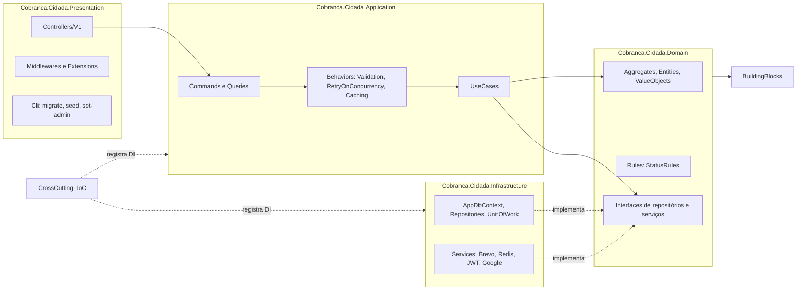
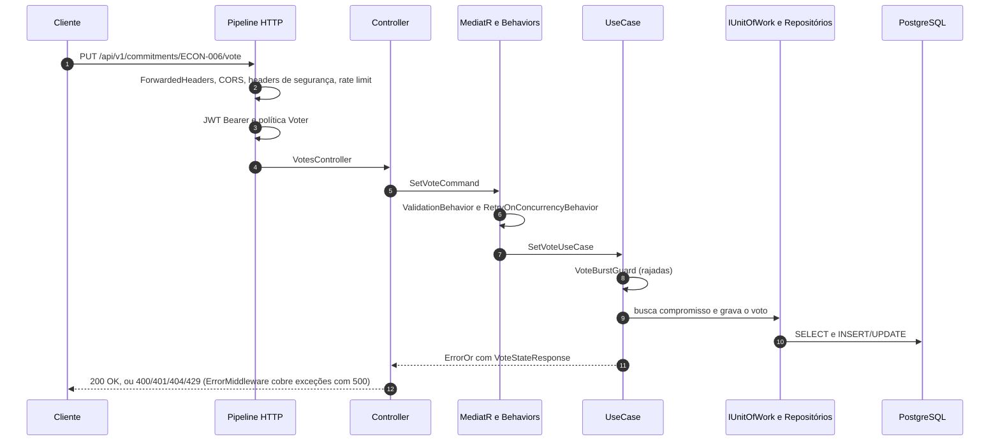
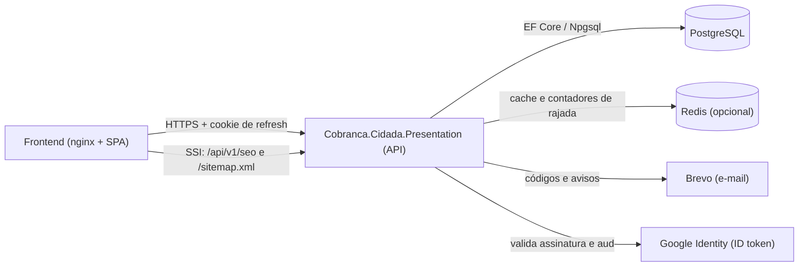
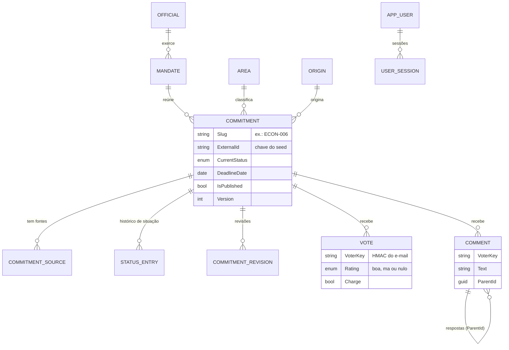

# Cobrança Cidadã — Backend

API REST que sustenta o **Cobrança Cidadã**: um site de cidadãos, **sem vínculo com o governo**, que confere com fonte pública se as promessas de campanha do presidente Lula (mandato 2027–2030) estão sendo cumpridas.


> Repositório irmão: [cobranca-cidada-frontend](https://github.com/luispizzilopes/cobranca-cidada-frontend). Para subir o sistema inteiro com um comando, veja o `docker compose` da raiz do monorepo local (`docker-compose.yml` e `README.md` na pasta pai).

## Índice

- [Visão geral](#visão-geral)
- [Stack tecnológica](#stack-tecnológica)
- [Arquitetura](#arquitetura)
- [API e contratos](#api-e-contratos)
- [Banco de dados e persistência](#banco-de-dados-e-persistência)
- [Segurança](#segurança)
- [Configuração e execução](#configuração-e-execução)
- [Linha de comando: migrate, seed e set-admin](#linha-de-comando-migrate-seed-e-set-admin)
- [Testes e qualidade](#testes-e-qualidade)
- [Executando com o frontend](#executando-com-o-frontend)
- [Regras de negócio que não podem quebrar](#regras-de-negócio-que-não-podem-quebrar)
- [Limitações conhecidas](#limitações-conhecidas)

## Visão geral

O backend é a **única fonte de dados** do sistema: os compromissos vivem apenas no banco. O JSON de levantamento entra **uma única vez**, pelo comando `seed`; depois disso nenhum endpoint lê o arquivo.

| Responsabilidade | O que faz |
|---|---|
| Catálogo | Compromissos, áreas, origens, fontes e filtros/paginação feitos no servidor |
| Situação de execução | Registro **editorial** da situação (com fonte e histórico imutável), regida por regras de domínio |
| Curadoria | Painel administrativo: criar/editar compromissos (com revisão), registrar situação, publicar, renomear áreas e origens |
| Votos | "Cobrar" e "Boa/Má proposta", só com e-mail verificado e **sem guardar e-mail ou identidade** no voto |
| Comentários | Opiniões públicas e anônimas, com censura de palavrões e moderação por admin |
| Contas | Cadastro por código de e-mail, login (senha ou Google), refresh rotativo, recuperação de senha, exclusão de conta (LGPD) |
| SEO | Sitemap e trechos de HTML por compromisso, injetados pelo nginx do frontend |

Dependências externas: **PostgreSQL** (obrigatório), **Redis** (opcional), **Brevo** (e-mail transacional; obrigatório em Produção) e **Google Identity** (opcional, login com Google).

## Stack tecnológica

| Tecnologia | Papel no projeto |
|---|---|
| [.NET 8](https://learn.microsoft.com/dotnet/core/whats-new/dotnet-8/overview) / [ASP.NET Core Web API](https://learn.microsoft.com/aspnet/core/web-api) | Runtime e framework HTTP (controllers versionados em `api/v1`) |
| [Entity Framework Core 8](https://learn.microsoft.com/ef/core/) + [Npgsql](https://www.npgsql.org/efcore/) | ORM e acesso ao PostgreSQL; migrações em `Infrastructure/Migrations` |
| [ASP.NET Core Identity](https://learn.microsoft.com/aspnet/core/security/authentication/identity) | Usuários, senhas (política de 12+ caracteres) e papéis, com stores em EF Core |
| [JWT Bearer](https://learn.microsoft.com/aspnet/core/security/authentication/) | Tokens de conta e de votante (assinatura simétrica) |
| [MediatR](https://github.com/jbogard/MediatR) | Command/Query → Handler; *pipeline behaviors* de validação, retentativa em conflito de concorrência e cache |
| [FluentValidation](https://docs.fluentvalidation.net/) | Validação de entrada (mensagens em português) |
| [ErrorOr](https://github.com/amantinband/error-or) | Resultado tipado para erros de negócio, convertido em HTTP por `ToActionResult` |
| [StackExchange.Redis](https://stackexchange.github.io/StackExchange.Redis/) | Cache (`RedisCacheService`) e contadores atômicos da detecção de rajadas de votos |
| [Google.Apis.Auth](https://github.com/googleapis/google-api-dotnet-client) | Validação do ID token do "Entrar com o Google" |
| [Brevo](https://developers.brevo.com/) | Envio de e-mail (códigos, avisos). Sem chave e fora de Produção, o e-mail vai para o log |
| [Serilog](https://serilog.net/) | Logging estruturado (sink de console) |
| [Swashbuckle](https://github.com/domaindrivendev/Swashbuckle.AspNetCore) | Swagger/OpenAPI em `/swagger` |
| [xUnit](https://xunit.net/) + [Testcontainers](https://dotnet.testcontainers.org/) | Testes; a integração usa PostgreSQL e Redis reais em contêiner |

Versões fixadas nos `.csproj`: EF Core/Identity 8.0.11, MediatR 14.0.0, FluentValidation 12.1.1, ErrorOr 2.0.1, Serilog 4.3.1, StackExchange.Redis 3.0.11.

## Arquitetura

Clean Architecture com DDD: as dependências apontam para dentro (`Presentation → Application → Domain`), e a `Infrastructure` implementa as interfaces declaradas no `Domain`/`Application`.



### Projetos da solution (`cobranca-cidada.sln`)

| Projeto | Responsabilidade |
|---|---|
| `Cobranca.Cidada.Domain` | Núcleo: `Modules/<Módulo>/{Aggregates,Entities,ValueObjects,Enums,Rules,Filters,Constants}` e as interfaces de repositórios/serviços |
| `Cobranca.Cidada.Application` | `Modules/<Módulo>/{Commands,Queries,UseCases,Requests,Responses,Validators,Services}`, `Behaviors` e `Common` |
| `Cobranca.Cidada.Infrastructure` | `Context` (EF), `Configuration` (mapeamentos), `Repositories`, `UnitOfWork`, `Services`, `Interceptor`, `Migrations` |
| `Cobranca.Cidada.Presentation` | `Controllers/V1`, `Extensions`, `Middlewares`, `Swagger`, `Cli` e `Program.cs` |
| `Cobranca.Cidada.BuildingBlocks` | `Entity`, `AggregateRoot`, `ValueObject`, eventos de domínio e paginação |
| `Cobranca.Cidada.CrossCutting` | Registro de injeção de dependências (`IoC`) |
| `Cobranca.Cidada.BackgroundJobs` | Reservado para jobs agendados. **Hoje contém apenas o `.csproj`, sem nenhum job implementado** |
| `Cobranca.Cidada.Tests` | Testes de domínio, aplicação, infraestrutura e integração |

### Módulos de negócio

| Módulo | Responsabilidade |
|---|---|
| `Commitment` | Agregado do compromisso, fontes, histórico imutável de situação (`StatusEntry`), revisões, consulta pública e seed |
| `Catalog` | Áreas e origens (tabelas de apoio editáveis) |
| `Mandate` | Agente político (`Official`) e mandato; todo compromisso pertence a um mandato |
| `Audit` | `AuditLog` das ações de curadoria e dos bloqueios por rajada |
| `Auth` | Cadastro, login (senha ou Google), refresh rotativo, logout, perfil, troca de senha/e-mail, recuperação de senha e exclusão de conta |
| `Voting` | Voto com e-mail verificado, desfazer, "meus votos", exclusão dos próprios votos e detecção de rajadas (`VoteBurstGuard`) |
| `Comment` | Comentários e respostas (um nível), destaques da tela inicial e moderação |
| `Moderation` | Tabela `ProfanityWords` e filtro de censura aplicado na gravação do comentário |
| `Seo` | Sitemap e fragmentos HTML (`head`/`body`) por compromisso |
| `Admin` (transversal) | Controllers `admin/commitments`, `admin/catalog` e a moderação de comentários, sob a política `Admin` |

### Padrões efetivamente usados

- **Controllers finos:** `_mediator.Send(...)` + `result.ToActionResult(this)`.
- **Command/Query → Handler → UseCase → `IUnitOfWork`.** Os `UseCase`s (`IUseCase`) são registrados por varredura de assembly; repositórios não são injetados direto neles.
- **Erros de negócio com `ErrorOr<T>`**, mapeados para HTTP em `ActionResultExtension` (`Validation→400`, `Unauthorized→401`, `Forbidden→403`, `NotFound→404`, `Conflict→409`, além de `429` com `Retry-After` e `503`).
- **IDs como *value objects*** (`CommitmentId`, etc.), convertidos nos `IEntityTypeConfiguration`.
- **Eventos de domínio** publicados por `DomainEventsPublishInterceptor` no EF Core.
- **Cache opcional:** `ICacheService` usa Redis quando há `ConnectionStrings:Redis`; senão `NoOpCacheService`. O `CachingBehavior` só age em queries marcadas com `ICacheableQuery` **e apenas em Produção**.
- Leituras com `AsNoTracking()`; entidades de domínio nunca são expostas (apenas `Responses`).

### Fluxo de uma requisição



A ordem do *pipeline* está em `RequestPipelineConfigurationExtension`: `ForwardedHeaders` (se ligado) → Swagger → CORS → cabeçalhos de segurança → HTTPS redirection → rate limiter → autenticação → autorização → `ErrorMiddleware` → controllers.

### Integrações



- **Sem Redis** (`ConnectionStrings:Redis` vazio): `NoOpCacheService` e contadores de rajada em memória (`MemoryVoteActivityStore`), aceitável só em desenvolvimento.
- **Sem Brevo** e fora de Produção: `ConsoleEmailService` escreve o código no log da API (sem registrar o destinatário).

## API e contratos

- Base: `/api/v1`. Os Swagger/OpenAPI ficam em **`/swagger`** (em Produção protegido por Basic Auth: `Swagger:Username` e `Swagger:Password`).
- **Autorização** (políticas em `IdentityDependencyInjection`): `Account` (token de conta), `Voter` (qualquer token com a claim `vk`, de conta ou de votante) e `Admin` (token de conta + claim `admin=true`).
- **Erros:** corpo `ErrorOr` com `code` e `description` (ex.: `Auth.ConsentRequired`, `Vote.BurstDetected`). Limite de taxa: `429` com `Retry-After`.
- Listas paginadas devolvem `{ items, totalCount, pageNumber, pageSize, totalPages }`.

> As rotas abaixo foram extraídas dos controllers em `Cobranca.Cidada.Presentation/Controllers/V1`. Os nomes de recursos são **em inglês** (`commitments`, `catalog`, `voter`, `votes`), mesmo que a interface do site use rotas em português.

### Público (sem token)

| Método | Endpoint | Descrição | Parâmetros |
|---|---|---|---|
| GET | `/api/v1/commitments` | Lista compromissos publicados | `search`, `area`, `origin`, `status`, `hasDeadline`, `sort` (`area`, `code`, `deadline`, `mais-cobradas`, `melhor-avaliadas`, `pior-avaliadas`), `myCharges` (exige token), `pageNumber`, `pageSize` (1–100, padrão 20) |
| GET | `/api/v1/commitments/{id}` | Detalhe com fontes e histórico (ex.: `ECON-006`) | — |
| GET | `/api/v1/catalog` | Áreas, origens e situações | — |
| GET | `/api/v1/commitments/{id}/comments` | Comentários do compromisso | `pageNumber`, `pageSize` (1–50, padrão 10) |
| GET | `/api/v1/comments/recent` | Último comentário raiz de cada compromisso | `limit` (1–12, padrão 3) |
| GET | `/api/v1/seo/head` · `/api/v1/seo/body` | HTML de SEO por página (usado pelo nginx) | `path` (ex.: `/compromissos/ECON-006`) |
| GET | `/sitemap.xml` | Sitemap (páginas estáticas e compromissos publicados) | — |

### Votante (e-mail verificado, sem conta)

| Método | Endpoint | Descrição | Auth |
|---|---|---|---|
| POST | `/api/v1/voter/code` | Envia código de 6 dígitos ao e-mail | — |
| POST | `/api/v1/voter/verify` | Confere o código e devolve o token de votante | — |
| PUT | `/api/v1/commitments/{id}/vote` | Define o voto | `Voter` |
| DELETE | `/api/v1/commitments/{id}/vote` | Desfaz o voto | `Voter` |
| GET | `/api/v1/votes/mine` | Lista/exporta os próprios votos | `Voter` |
| DELETE | `/api/v1/votes/mine` | Apaga todos os próprios votos | `Voter` |
| POST | `/api/v1/commitments/{id}/comments` | Comenta (`{ text, parentId? }`) | `Voter` |
| DELETE | `/api/v1/comments/{commentId}` | Apaga o próprio comentário | `Voter` |

### Conta (`/api/v1/authentication`)

| Método | Endpoint | Descrição | Auth |
|---|---|---|---|
| POST | `/request-registration-code` | Pede o código de cadastro | — |
| POST | `/register` | Cria a conta (`name`, `email`, `password`, `code`, `acceptedPrivacyPolicy`) | — |
| POST | `/login` | Login com e-mail e senha | — |
| POST | `/google` | Login com ID token do Google (`credential`, `acceptedPrivacyPolicy`); `503` sem `ClientId` | — |
| POST | `/refresh` | Renova a sessão pelo cookie HttpOnly | cookie |
| POST | `/logout` | Encerra a sessão do cookie | cookie |
| POST | `/request-password-reset` · `/confirm-password-reset` | Recuperação de senha por código | — |
| POST | `/request-email-change` · `/confirm-email-change` | Troca de e-mail (endpoints existem; o site não tem tela para isso) | `Account` |
| POST | `/change-password` | Troca de senha logado | `Account` |
| GET | `/me` | Perfil | `Account` |
| DELETE | `/me` | Exclui a conta (`password` ou `googleCredential`) | `Account` |

### Administração (`Admin`)

| Método | Endpoint | Descrição |
|---|---|---|
| GET | `/api/v1/admin/commitments` | Lista (filtros `search`, `area`, `origin`, `status`, `published`, `sort`) |
| GET | `/api/v1/admin/commitments/{id}` | Detalhe com revisões |
| POST | `/api/v1/admin/commitments` | Cria (nasce despublicado, salvo `publish`) |
| PUT | `/api/v1/admin/commitments/{id}` | Edita (`ExpectedVersion` e motivo obrigatórios) |
| POST | `/api/v1/admin/commitments/{id}/status` | Registra situação |
| PUT | `/api/v1/admin/commitments/{id}/publication` | Publica/despublica |
| PUT | `/api/v1/admin/catalog/areas/{code}` · `/origins/{code}` | Renomeia área/origem |
| DELETE | `/api/v1/admin/comments/{commentId}` | Moderação de comentário (registra `AuditLog`) |

### Exemplos

Votar (`PUT /api/v1/commitments/ECON-006/vote`, `Authorization: Bearer <token>`):

```json
{ "rating": "boa", "charge": true }
```

`rating` aceita `"boa"`, `"ma"` ou `null`. Sem avaliação e com `charge: false`, o voto é desfeito. Resposta (`VoteStateResponse`):

```json
{
  "commitmentId": "ECON-006",
  "myVote": { "rating": "boa", "charge": true },
  "votes": { "charges": 12, "chargesHidden": false, "good": 8, "bad": 3, "ratingsHidden": false }
}
```

Lista (`GET /api/v1/commitments?area=ECON&pageSize=1`, formato de `CommitmentSummaryResponse`; valores ilustrativos, campos de texto omitidos por brevidade):

```json
{
  "items": [
    {
      "id": "ECON-006",
      "area": { "code": "ECON", "name": "…" },
      "origin": { "code": "plano-de-governo", "name": "…" },
      "status": { "value": "NotEvaluated", "label": "Não avaliado" },
      "hasPlanDetail": true,
      "votes": { "charges": 0, "chargesHidden": false, "good": 0, "bad": 0, "ratingsHidden": false },
      "myVote": null
    }
  ],
  "totalCount": 163,
  "pageNumber": 1,
  "pageSize": 1,
  "totalPages": 163
}
```

Os demais campos (`title`, `shortDescription`, `statusDate`, `date`, `dateKind`, `deadlineText`, `goalOrCondition`, `classification`, `evidence`, `planPage`) estão em `Application/Modules/Commitment/Responses` e no Swagger. `totalCount` de 163 é o total da carga inicial do seed.

Login (`POST /api/v1/authentication/login`): corpo `{ "email": "…", "password": "…" }`; a resposta traz `userId`, `email`, `name`, `roles`, `token` e `dateExpiration`. O *refresh token* **não** vai no JSON: é gravado no cookie `cobranca.refresh` (HttpOnly, `Path=/api/v1/authentication`).

## Banco de dados e persistência

- **PostgreSQL 16** via **EF Core + Npgsql**. Contexto: `AppDbContext` (`Infrastructure/Context`), que também hospeda as tabelas do Identity.
- **Acesso a dados:** repositórios por módulo (`Infrastructure/Repositories`) atrás de `IUnitOfWork`; transações explícitas via `ExecuteInTransactionAsync` (ex.: a troca de e-mail migra votos e comentários na mesma transação).
- **Concorrência:** índice único no par (`VoterKey`, compromisso) para votos; envios simultâneos são reexecutados por `RetryOnConcurrencyBehavior`. A edição de compromisso usa `Version` (`ExpectedVersion`, `409` se desatualizada).
- **Busca:** `ILIKE`, **ainda sem ignorar acentos**.
- **Cache:** Redis opcional (veja [Integrações](#integrações)).

### Modelo de dados (principais entidades)



`Vote` e `Comment` guardam só a `VoterKey` (nunca e-mail, nome ou usuário), por isso não têm chave estrangeira para `APP_USER`. Há ainda `AuditLog`, `VoterIdentity` (revogação de tokens de votante) e `ProfanityWord` (lista de censura, com carga inicial na migração `AddProfanityWords`).

### Migrações

Migrações existentes (em ordem): `InitialCatalog`, `AddIdentityAndVoting`, `AddAdminFlag`, `AddComments`, `AddCommentReplies`, `AddProfanityWords`.

```bash
# aplicar (também cria os papéis do Identity)
dotnet run --project Cobranca.Cidada.Presentation -- migrate

# criar uma nova migração
dotnet ef migrations add <Nome> \
  --project Cobranca.Cidada.Infrastructure \
  --startup-project Cobranca.Cidada.Presentation \
  --output-dir Migrations
```

## Segurança

Mecanismos **implementados** no código:

| Tema | Implementação |
|---|---|
| Tokens | Dois tipos de JWT: **conta** (`typ=user`, com `sid` e papéis) e **votante** (`typ=voter`, claim `vk`). Expiração configurável em `TokenConfiguration` (conta 60 min, votante 30 dias, refresh 30 dias por padrão) |
| Sessões | Refresh token em **cookie HttpOnly** (`cobranca.refresh`, `Secure` e `SameSite=None` fora de Localhost/Testing), rotação a cada uso, detecção de reuso e revogação. `refresh` e `logout` conferem a origem da requisição |
| Senhas | Identity: 12+ caracteres, maiúscula, minúscula, dígito, símbolo e 4 caracteres únicos; bloqueio após 5 falhas; login com resposta idêntica para conta inexistente |
| Códigos por e-mail | Guardados só como hash, validade de 15 min, 5 tentativas, intervalo mínimo de 60 s; o pedido de código responde igual exista ou não a conta |
| Voto anônimo | `VoterKey = HMAC-SHA256(segredo, e-mail canônico)`; a tabela de votos nunca guarda e-mail ou usuário |
| Admin | Flag `IsAdmin` no banco, concedida só por CLI (`set-admin`) ou SQL; a claim é reconferida no banco a cada requisição (revogar vale na hora) |
| Rate limiting | Políticas por IP/pessoa: `public-read` (120/min), `auth-anonymous` (30/15 min), `email-code` (10/15 min), `vote` (60/min), `comment` (10/min), `admin` (120/min), `seo` (6000/min); resposta `429` + `Retry-After` |
| Rajadas de voto | `VoteBurstGuard` com contadores atômicos no Redis (bloqueios por pessoa/IP, alerta de pico por compromisso); registra no `AuditLog` sem IP ou e-mail em claro |
| CORS | Origens liberadas apenas em `Cors:AllowedOrigins`, com credenciais |
| Cabeçalhos | `X-Content-Type-Options: nosniff`, `X-Frame-Options: DENY`, `Referrer-Policy: no-referrer`, CSP `default-src 'none'` (exceto `/swagger`) |
| Proxy reverso | `ForwardedHeaders` desligado por padrão; ligado, **exige** `KnownProxies`/`KnownNetworks` (a API recusa subir sem eles) |
| Segredos em Produção | A API **não sobe** sem `Jwt:key` e `Voting:EmailHmacKey` (32+ caracteres, sem `CHANGE_ME`), `Seo:SiteUrl` (não `localhost`), `BrevoSettings:ApiKey` e `Swagger:Password` |
| Erros | Em Produção o `ErrorMiddleware` devolve mensagem genérica; em outros ambientes, a mensagem da exceção |
| Privacidade | Sem e-mail ou identidade de votante em logs; `GET/DELETE /votes/mine` e `DELETE /authentication/me` atendem à LGPD |

Pendências reconhecidas (**não** implementadas): CAPTCHA acionado por risco, bloqueio de e-mails descartáveis e CI. Veja [Limitações conhecidas](#limitações-conhecidas).

## Configuração e execução

### Pré-requisitos

- [.NET SDK 8](https://dotnet.microsoft.com/download/dotnet/8.0)
- [Docker](https://docs.docker.com/get-docker/) (PostgreSQL, Redis e os testes de integração)
- Opcional: `dotnet-ef` para criar migrações (`dotnet tool install --global dotnet-ef`)

### Passo a passo (desenvolvimento)

```bash
git clone https://github.com/luispizzilopes/cobranca-cidada-backend.git
cd cobranca-cidada-backend

# PostgreSQL (porta 5433) e Redis (porta 6380)
docker compose up -d postgres redis

export ASPNETCORE_ENVIRONMENT=Development
dotnet run --project Cobranca.Cidada.Presentation -- migrate
dotnet run --project Cobranca.Cidada.Presentation -- seed --file <caminho>/promessas-lula-eleicoes-2026.json
dotnet run --project Cobranca.Cidada.Presentation        # http://localhost:5399/swagger
```

O arquivo de seed (`promessas-lula-eleicoes-2026.json`) fica em `docs/dados/` do monorepo (pasta acima deste repositório). No layout do monorepo, use `--file ../docs/dados/promessas-lula-eleicoes-2026.json`.

O ambiente **`Development`** vem pronto no repositório (`appsettings.Development.json`): conexão com o Postgres em `localhost:5433` com as credenciais do `docker-compose.yml` (apenas de desenvolvimento) e CORS para `http://localhost:5173` e `:5174`. O Redis fica **desligado** (`ConnectionStrings:Redis` vazio) e o e-mail vai para o log. O ambiente `Localhost` (`appsettings.Localhost.json`) é um arquivo **ignorado pelo git**, para sobrescritas pessoais; se criá-lo, não versione chaves reais.

A API escuta em `http://localhost:5399` (veja `Properties/launchSettings.json`). Sem chave do Brevo, o código de e-mail aparece no log do console.

### Contêineres

```bash
# API + Postgres + Redis (depois rode migrate e seed contra o banco)
docker compose --profile full up --build
```

Para o sistema completo (API, site, migração e seed automáticos), use o `docker compose up --build` da raiz do monorepo.

### Variáveis de configuração

Em .NET, `Secao:Chave` vira `Secao__Chave` como variável de ambiente.

| Chave | Descrição | Obrigatória em Produção |
|---|---|---|
| `ConnectionStrings__DefaultConnection` | Conexão PostgreSQL | sim |
| `ConnectionStrings__Redis` | Redis (vazio = sem cache; contadores em memória) | recomendado |
| `Jwt__key` | Chave de assinatura dos JWT (32+ caracteres) | sim |
| `Voting__EmailHmacKey` | Segredo do HMAC da `VoterKey` (32+ caracteres) | sim |
| `BrevoSettings__ApiKey` / `FromEmail` / `FromName` | E-mail transacional (também aceita a variável `BREVO_API_KEY`) | sim |
| `Seo__SiteUrl` | Endereço público do site (não pode ser `localhost`) | sim |
| `Swagger__Password` (e `Swagger__Username`) | Basic Auth do `/swagger` | sim |
| `Cors__AllowedOrigins__0` | Origem do site | sim |
| `Authentication__Google__ClientId` | ID do cliente OAuth do Google (vazio = sem login Google; `503` na rota) | não |
| `ForwardedHeaders__Enabled`, `__KnownProxies__0`, `__KnownNetworks__0` | Atrás de proxy/balanceador | se houver proxy |
| `RateLimits__PublicRead` / `AuthAnonymous` / `EmailCode` / `Vote` / `Comment` / `Admin` / `Seo` | Limites de taxa | não |
| `Voting__Burst__*` | Limiares da detecção de rajadas de votos | não |
| `TokenConfiguration__AccessTokenExpireMinutes` etc. | Validade dos tokens | não |

Exemplo **seguro** (valores de exemplo que a API recusa em Produção):

```bash
export ConnectionStrings__DefaultConnection="Host=localhost;Port=5433;Database=cobranca_cidada;Username=cobranca;Password=<senha>"
export Jwt__key="<chave-aleatoria-com-32-ou-mais-caracteres>"
export Voting__EmailHmacKey="<outro-segredo-com-32-ou-mais-caracteres>"
```

> Nunca versione chaves reais (Brevo, JWT, HMAC). Use variáveis de ambiente ou um gerenciador de segredos.

### Build e deploy

```bash
dotnet build cobranca-cidada.sln
dotnet publish Cobranca.Cidada.Presentation -c Release
```

O `Cobranca.Cidada.Presentation/Dockerfile` (multi-stage, imagem `aspnet:8.0`, usuário não-root, porta 8080) é o artefato de deploy documentado no repositório. Não há pipeline de CI/CD no repositório; o provedor de nuvem não está definido.

## Linha de comando: migrate, seed e set-admin

Subcomandos de `Cobranca.Cidada.Presentation`; executam e encerram, sem subir o servidor HTTP.

| Comando | Efeito |
|---|---|
| `migrate` | Aplica as migrações e cria os papéis do Identity |
| `seed --file <json> [--overwrite] [--mandate-start yyyy-MM-dd] [--mandate-end yyyy-MM-dd]` | Carga inicial dos compromissos |
| `set-admin --email <e-mail> [--revoke]` | Concede (ou retira) a flag de administrador de uma conta existente |

**Seed:** idempotente (chave natural `ExternalId`); ignora IDs que já existem e só os atualiza com `--overwrite` (gerando revisão). Imprime um relatório com criados, atualizados, ignorados e rejeitados (com o motivo) e **sai com código 1** se algum item for rejeitado. Mandato padrão: `Presidência da República 2027–2030`, de `2027-01-05` a `2030-12-31` (a data de posse deve ser confirmada).

## Testes e qualidade

- **Frameworks:** xUnit 2.5, `Microsoft.AspNetCore.Mvc.Testing` e Testcontainers (PostgreSQL e Redis reais). Regra do projeto: nunca mockar o banco.
- **Organização (`Cobranca.Cidada.Tests`):**
  - `Domain/` — agregados e regras puras (`StatusRulesTests`, `CommitmentTests`, `VoteTests`).
  - `Application/` — validators, mapper do seed, **contrato do arquivo de seed**, `VotePolicy`, censura e `SeoPageRenderer` (escape de HTML e JSON-LD).
  - `Infrastructure/` — normalização de e-mail e `VoterKey`, `ForwardedHeaders`, armazenamento de códigos e de atividade de votos.
  - `Integration/` — API completa contra Postgres real: conta, votos, comentários, administração, login com Google (verificador falso), SEO, rajadas (também contra Redis real).

```bash
dotnet test Cobranca.Cidada.Tests            # a parte de integração exige Docker em execução
dotnet test Cobranca.Cidada.Tests --collect:"XPlat Code Coverage"   # cobertura (coverlet.collector)
```

Análise estática: não há ferramenta dedicada configurada além dos analisadores padrão do compilador (`dotnet build`).

## Executando com o frontend

1. Suba este backend (`migrate`, `seed` e `dotnet run`, porta **5399**).
2. No [frontend](https://github.com/luispizzilopes/cobranca-cidada-frontend), defina `VITE_API_URL=http://localhost:5399` e rode `npm run dev` (porta **5173**).
3. O CORS do backend já libera `http://localhost:5173` no ambiente `Development`.

Para login com Google, informe o **mesmo** ID de cliente nos dois lados: `Authentication__Google__ClientId` (API) e `VITE_GOOGLE_CLIENT_ID` (site). Em produção, o endereço público do site deve ser o mesmo em `Seo__SiteUrl` (API), `VITE_SITE_URL` (build do site) e `SITE_URL` (contêiner do site).

## Regras de negócio que não podem quebrar

- **Compromissos só no banco.** O JSON entra apenas pelo `seed`.
- **Regras de situação num lugar só:** `Domain/Modules/Commitment/Rules/StatusRules.cs`. Nunca "Descumprido" antes do prazo; sem prazo estruturado, só com ato formal e fonte.
- **Voto não altera situação.** Contagens nunca entram em `CurrentStatus`; a API nunca devolve votos individuais.
- **O voto nunca guarda e-mail nem usuário**, só a `VoterKey`.
- **Trocar o e-mail muda a chave do votante:** a troca migra votos e comentários na mesma transação e encerra as sessões.
- **Comentário é anônimo para o público** (`isMine` apenas), 3 a 1000 caracteres, até 5 comentários raiz por pessoa por compromisso; a censura grava o texto já censurado.
- **SEO:** o fragmento só tem conteúdo para `/compromissos/{slug}` publicado; nenhum dado de voto vai para o HTML.
- **Não invente dados:** toda afirmação sobre promessa ou execução precisa de fonte com URL.

O detalhamento das decisões (D1–D8) está em `docs/decisoes.md` no monorepo.

## Limitações conhecidas

- `BackgroundJobs` ainda não tem jobs; a agregação de votos é calculada na consulta (`GROUP BY`).
- Busca `ILIKE` sem normalização de acentos.
- Alias de Gmail (`a.b@`, `a+x@`) não casa com a conta existente no login com Google (os votos se unem pela `VoterKey`).
- MediatR 14 exibe aviso de licença comercial em produção; decidir antes de publicar.
- Sem CI e sem imagem de compartilhamento por compromisso.
